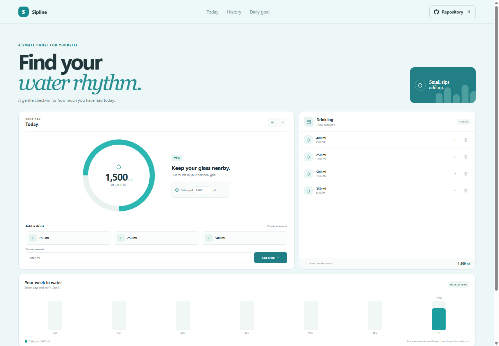

# Sipline: Hydration Tracker

Sipline makes it quick to record a glass, check today's total, and adjust a personal water goal. The daily view is a lightweight reminder to notice your own routine.

**Project repository:** https://github.com/a2rp/hydration-tracker
**Deployed site:** https://a2rp.github.io/hydration-tracker/

## What is included

- A progress ring showing today's water against a chosen daily goal.
- Quick add buttons for common drink sizes and a custom milliliter entry.
- A timestamped daily drink log with confirmed removal.
- Previous and next day navigation to review the saved history.
- A seven-day bar chart showing totals against the current goal.

## How to use it

Tap a quick amount or enter a custom amount to add a drink. Adjust the daily target in the goal card. Use the date arrows to review another day's entries; new drinks can be added to today. Remove an incorrect drink using its delete button and confirm the named entry.

## Data and limits

Drink entries and the goal are stored in localStorage in this browser and do not sync between devices. Sample entries appear the first time the app is opened. A single milliliter unit is used for all values. Hydration needs vary with health, climate, and activity; the default target is only an example, not medical advice.

## Run and check locally

Install dependencies with `npm install`, then start the app with `npm run dev`. Run `npm run lint` for ESLint and `npm run build` for the production check. Run `npm run deploy` to build and publish `dist` to the `gh-pages` branch.

## Future improvements

Ideas only. These are not implemented yet:

- Add optional beverage types and a unit switcher.
- Add reminders that can be enabled or disabled.
- Add a calendar export for daily totals.

## Links

- Portfolio: [https://www.ashishranjan.net](https://www.ashishranjan.net)
- GitHub: [https://github.com/a2rp](https://github.com/a2rp)
- CodePen: [https://codepen.io/ash1198](https://codepen.io/ash1198)
- LinkedIn: [https://www.linkedin.com/in/aashishranjan](https://www.linkedin.com/in/aashishranjan)
- Facebook: [https://www.facebook.com/theash.ashish/](https://www.facebook.com/theash.ashish/)
- YouTube: [https://www.youtube.com/@ashishranjan-ashz?sub_confirmation=1](https://www.youtube.com/@ashishranjan-ashz?sub_confirmation=1)
- Email: [mailto:ash.ranjan09@gmail.com](mailto:ash.ranjan09@gmail.com)

## Support

- Support: [https://a2rp-donation-page.netlify.app/](https://a2rp-donation-page.netlify.app/)
- Buy Me a Coffee: [https://buymeacoffee.com/ashishranjan](https://buymeacoffee.com/ashishranjan)
- Patreon: [https://www.patreon.com/ashishranjan](https://www.patreon.com/ashishranjan)